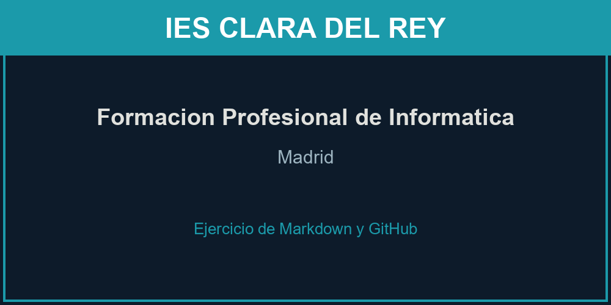

# IES Clara del Rey

## Un instituto de Madrid con nombre de heroína

El **IES Clara del Rey** es un instituto público de *Madrid* en el que, además de la
ESO y el Bachillerato, se imparte **Formación Profesional de Informática**. En estos
estudios se aprende a montar equipos, administrar sistemas y redes, y usar herramientas
como el control de versiones con `git`.

---

## ¿Qué se estudia en Informática?

Las áreas que más se trabajan en los ciclos de informática son:

- Montaje y mantenimiento de equipos.
- Sistemas operativos (Windows y Linux).
- Redes locales y servicios de red.
- Seguridad informática.
- Programación y desarrollo de aplicaciones.

El itinerario típico del alumnado suele ser:

1. Elegir un **ciclo** (grado medio o superior).
2. Cursar **primer curso** con los módulos básicos.
3. Cursar **segundo curso** con los módulos avanzados.
4. Hacer las **prácticas en empresa (FCT)** y titular.

## Un ejemplo de código

Comandos típicos que usamos en Linux para revisar la red:

```bash
# Ver las interfaces de red y comprobar la conexion
ip addr show
ping -c 4 8.8.8.8
```

## Ciclos de FP de Informática (en España)

| Ciclo                                          | Grado    | Duración |
|------------------------------------------------|----------|----------|
| Sistemas Microinformáticos y Redes (SMR)       | Medio    | 2 años   |
| Administración de Sistemas Informáticos (ASIR) | Superior | 2 años   |
| Desarrollo de Aplicaciones Web (DAW)           | Superior | 2 años   |

## Enlaces

- Información oficial de la Comunidad de Madrid sobre
  [Formación Profesional](https://www.comunidad.madrid/servicios/educacion/formacion-profesional).
- Más detalles sobre el instituto en este repositorio:
  [Ver detalles](docs/detalles.md).

## Imagen del proyecto (imagen local)



## El instituto (imagen externa de Wikimedia)

El **IES Clara del Rey** está en el barrio de *Prosperidad* (Madrid) y lleva el nombre
de **Clara del Rey**, una de las heroínas del *levantamiento del 2 de mayo de 1808*.
Esta foto del edificio procede de Wikimedia Commons:


